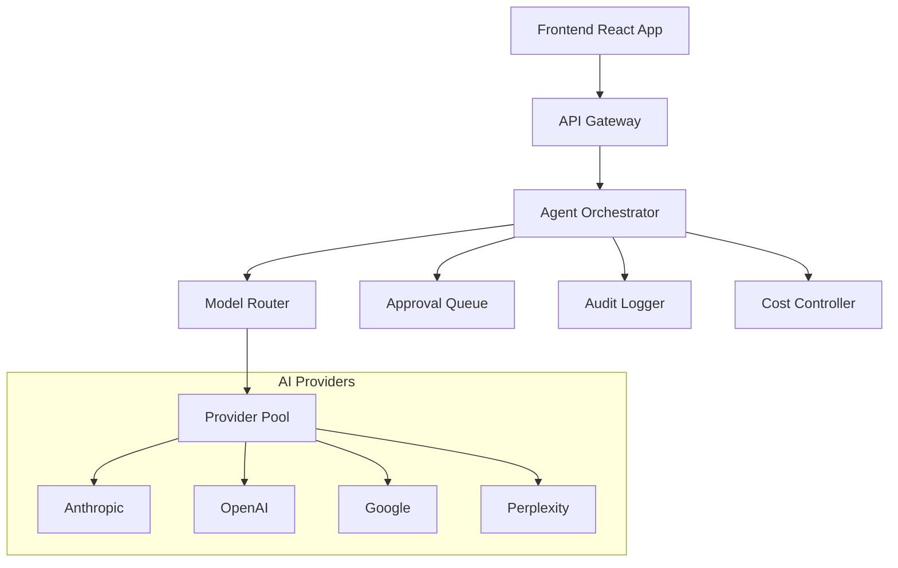
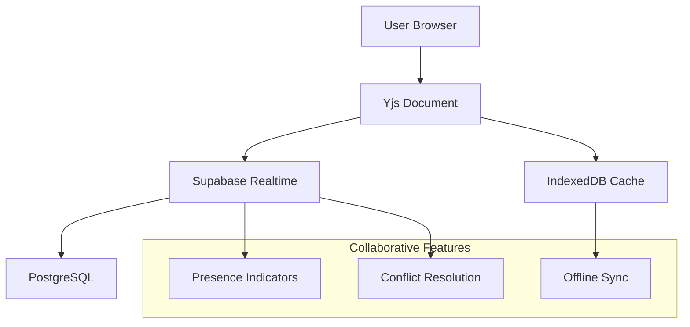

# Cutting-Edge Features Implementation Roadmap for Imba CRM

## Executive Summary

This document presents a comprehensive analysis of cutting-edge technology opportunities for Imba CRM, focusing on AI-native CRM capabilities, agentic workflows, and emerging technology integrations. The roadmap prioritizes features that align with current market trends while leveraging the existing monorepo architecture (React frontend + Supabase + model-router).

## Current Architecture Analysis

### Tech Stack Foundation
- **Frontend**: React 18 + TypeScript + Vite + Tailwind CSS
- **Backend**: Supabase (PostgreSQL + Auth + Edge Functions)
- **AI Infrastructure**: Model-router service with multi-provider support (Anthropic, OpenAI, Google, Perplexity, Deepgram, Ollama)
- **Deployment**: Docker + Nginx + Docker Compose

### Existing Capabilities
- Multi-provider AI routing with cost tracking
- CRM modules: Pipeline, Leads, Inbox, Outreach, Proposals, Invoices, Analytics
- Admin-first architecture with role-based access
- AI features split between Edge Functions and direct browser calls

### Critical Gaps Identified
1. **Security**: Direct browser-to-provider AI calls expose API keys
2. **Governance**: No AI audit trail or cost controls
3. **Multi-tenancy**: Single-tenant architecture limits scalability
4. **Real-time**: Limited real-time collaboration features
5. **Integration**: Missing calendar/email sync capabilities

## Cutting-Edge Feature Opportunities

### 1. AI Agentic Workflow Engine (P0 Priority)

**Market Alignment**: HubSpot's Prospecting Agent, Microsoft Copilot for Sales, Salesforce Agentic Enterprise

**Technical Implementation**:
```typescript
// Agent orchestration system
interface AIAgent {
  id: string;
  name: string;
  capabilities: AgentCapability[];
  constraints: AgentConstraint[];
  approvalRequired: boolean;
}

interface AgentCapability {
  type: 'research' | 'draft' | 'classify' | 'extract' | 'reason';
  providers: string[];
  maxCost: number;
  timeout: number;
}
```

**Features**:
- **Prospecting Agent**: Automated lead research with Perplexity integration
- **Communication Agent**: AI-powered email drafting with approval workflows
- **Analysis Agent**: Automated lead scoring and pipeline insights
- **Research Agent**: Real-time company intelligence and market analysis

**Implementation Timeline**: 4-6 weeks
**Technical Requirements**:
- Extend model-router with agent orchestration
- Implement approval queue system
- Add agent cost tracking and limits
- Create agent performance analytics

### 2. Real-Time Collaboration Hub (P1 Priority)

**Market Alignment**: Modern collaborative CRMs with real-time sync

**Technical Implementation**:
```typescript
// Real-time collaboration using Yjs + Supabase Realtime
interface CollaborativeSpace {
  id: string;
  type: 'lead' | 'proposal' | 'inbox';
  participants: User[];
  document: Y.Doc;
  awareness: awarenessProtocol.Awareness;
}
```

**Features**:
- **Multi-user editing**: Real-time collaboration on proposals and notes
- **Presence indicators**: Live user presence across CRM modules
- **Conflict resolution**: Automatic conflict resolution for concurrent edits
- **Offline sync**: Seamless offline-to-online synchronization

**Implementation Timeline**: 3-4 weeks
**Technical Requirements**:
- Integrate Yjs with existing TipTap editor
- Implement Supabase Realtime for presence
- Add offline storage using IndexedDB
- Create conflict resolution algorithms

### 3. Unified Intelligence Layer (P1 Priority)

**Market Alignment**: Attio's relationship intelligence, Salesforce Customer 360

**Technical Implementation**:
```typescript
// Knowledge graph for relationship intelligence
interface RelationshipGraph {
  nodes: EntityNode[];
  edges: RelationshipEdge[];
  embeddings: number[][];
  lastUpdated: Date;
}

interface EntityNode {
  id: string;
  type: 'contact' | 'company' | 'deal' | 'email' | 'meeting';
  properties: Record<string, any>;
  embedding: number[];
}
```

**Features**:
- **Email/Calendar Sync**: Automatic data ingestion from Google/Microsoft
- **Relationship Scoring**: AI-powered relationship strength analysis
- **Context Enrichment**: Automatic lead and company enrichment
- **Knowledge Graph**: Visual relationship mapping across contacts

**Implementation Timeline**: 6-8 weeks
**Technical Requirements**:
- Implement OAuth for Google/Microsoft integration
- Create webhook handlers for email/calendar events
- Build vector embedding pipeline using pgvector
- Develop relationship scoring algorithms

### 4. Advanced Analytics & Predictive Insights (P2 Priority)

**Market Alignment**: Predictive CRM analytics with ML capabilities

**Technical Implementation**:
```typescript
// Predictive analytics engine
interface PredictionModel {
  id: string;
  type: 'conversion' | 'churn' | 'deal-size' | 'timeline';
  accuracy: number;
  features: string[];
  model: 'xgboost' | 'random-forest' | 'neural-network';
}

interface PredictionResult {
  prediction: number | boolean;
  confidence: number;
  factors: Explanation[];
  recommendations: string[];
}
```

**Features**:
- **Deal Prediction**: AI-powered deal closure probability
- **Churn Prevention**: Customer churn risk assessment
- **Revenue Forecasting**: Predictive revenue pipeline analysis
- **Next Best Action**: AI-recommended sales actions

**Implementation Timeline**: 8-10 weeks
**Technical Requirements**:
- Implement ML model training pipeline
- Create feature engineering system
- Build explanation generation for predictions
- Add A/B testing framework for recommendations

### 5. Blockchain-Based Audit Trail (P2 Priority)

**Market Alignment**: Enterprise-grade audit and compliance requirements

**Technical Implementation**:
```typescript
// Blockchain audit system using Polygon or similar
interface BlockchainAudit {
  hash: string;
  previousHash: string;
  timestamp: Date;
  action: string;
  userId: string;
  dataHash: string;
  signature: string;
}
```

**Features**:
- **Immutable Audit Trail**: Tamper-proof action logging
- **Smart Contract Integration**: Automated compliance checking
- **Decentralized Verification**: Multi-party verification system
- **Compliance Reporting**: Automated compliance report generation

**Implementation Timeline**: 6-8 weeks
**Technical Requirements**:
- Implement blockchain integration (Polygon/Ethereum)
- Create cryptographic hashing for audit entries
- Build smart contract for compliance rules
- Develop verification dashboard

## Implementation Strategy

### Phase 1: Foundation (Weeks 1-4)
1. **Security Hardening**: Complete secret separation and remove direct browser calls
2. **AI Governance**: Implement audit logging and cost controls
3. **Multi-tenancy**: Add organization-based data isolation
4. **Performance**: Implement code splitting and optimization

### Phase 2: Intelligence Layer (Weeks 5-8)
1. **Agent Framework**: Build agent orchestration system
2. **Real-time Sync**: Implement collaborative features
3. **Integration Hub**: Add email/calendar sync capabilities
4. **Knowledge Graph**: Create relationship intelligence system

### Phase 3: Advanced Features (Weeks 9-16)
1. **Predictive Analytics**: Implement ML-based predictions
2. **Blockchain Audit**: Add immutable audit trail
3. **Advanced Automation**: Expand agent capabilities
4. **Performance Optimization**: Optimize for scale

## Technical Architecture Changes

### Enhanced Model-Router Architecture


### Real-Time Collaboration Architecture


## Security Considerations

### Enhanced Security Measures
1. **Zero-trust Architecture**: Implement service-to-service authentication
2. **API Rate Limiting**: Add comprehensive rate limiting per organization
3. **Data Encryption**: Implement end-to-end encryption for sensitive data
4. **Compliance**: Add GDPR, CCPA, and SOC 2 compliance features
5. **Audit Logging**: Comprehensive audit trail for all actions

### Privacy-Preserving AI
1. **Data Anonymization**: Implement PII detection and anonymization
2. **Consent Management**: Add granular consent management system
3. **Data Retention**: Implement automated data retention policies
4. **Right to Erasure**: Add GDPR-compliant data deletion capabilities

## Performance Optimization

### Scalability Improvements
1. **Edge Computing**: Implement edge functions for global performance
2. **Caching Strategy**: Multi-layer caching (CDN, Redis, browser)
3. **Database Optimization**: Query optimization and indexing strategy
4. **Microservices**: Decompose into microservices architecture

### Monitoring & Observability
1. **Distributed Tracing**: Implement OpenTelemetry tracing
2. **Performance Monitoring**: Add real-user monitoring (RUM)
3. **Error Tracking**: Comprehensive error tracking and alerting
4. **Cost Monitoring**: Real-time cost tracking and optimization

## Development Timeline & Resource Requirements

### Resource Allocation
- **Full-stack Engineers**: 3-4 engineers
- **AI/ML Engineer**: 1 engineer
- **DevOps Engineer**: 1 engineer
- **Product Designer**: 0.5 FTE
- **Product Manager**: 0.25 FTE

### Total Timeline: 16-20 weeks
- **Phase 1**: 4 weeks
- **Phase 2**: 4 weeks  
- **Phase 3**: 8-12 weeks

## Success Metrics

### Business Metrics
- **User Engagement**: 30% increase in daily active users
- **Sales Efficiency**: 25% reduction in sales cycle time
- **AI Adoption**: 80% of users actively using AI features
- **Customer Satisfaction**: NPS score improvement of 15+ points

### Technical Metrics
- **Performance**: <2s page load time globally
- **Reliability**: 99.9% uptime SLA
- **Security**: Zero critical security vulnerabilities
- **Cost Efficiency**: 20% reduction in AI provider costs

## Risk Assessment & Mitigation

### Technical Risks
1. **AI Provider Dependencies**: Implement multi-provider fallback
2. **Data Privacy Regulations**: Implement privacy-by-design approach
3. **Scalability Challenges**: Design for horizontal scaling from day one
4. **Integration Complexity**: Use standardized APIs and webhooks

### Business Risks
1. **Market Competition**: Focus on unique AI-native capabilities
2. **User Adoption**: Implement gradual rollout with user training
3. **Cost Overruns**: Implement strict cost monitoring and controls
4. **Compliance Issues**: Engage legal counsel for compliance review

## Conclusion

This cutting-edge features roadmap positions Imba CRM as a next-generation AI-native CRM platform. By focusing on agentic workflows, real-time collaboration, and unified intelligence, we can differentiate from traditional CRMs while building on the solid technical foundation already in place.

The implementation strategy balances innovation with practicality, ensuring each feature delivers measurable business value while maintaining the security and reliability required for enterprise adoption.