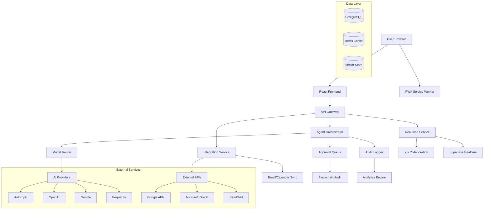
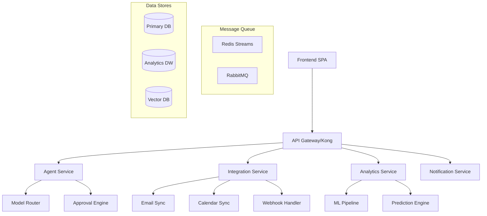
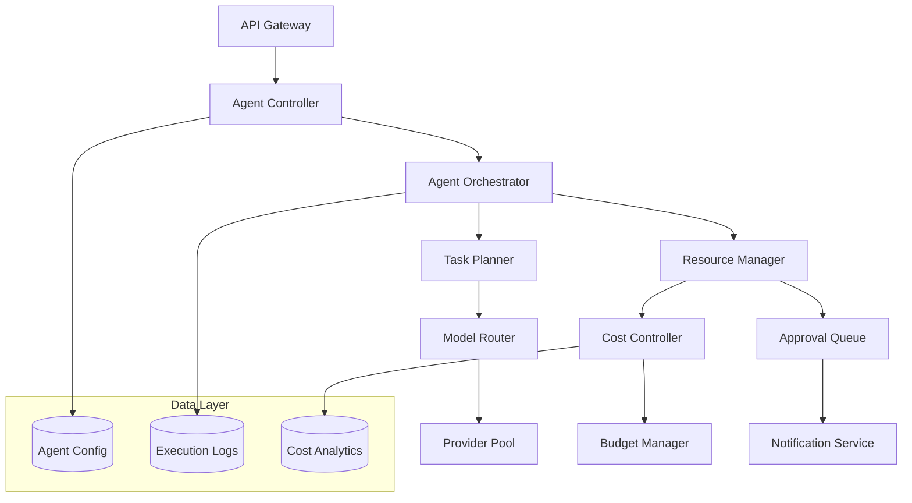
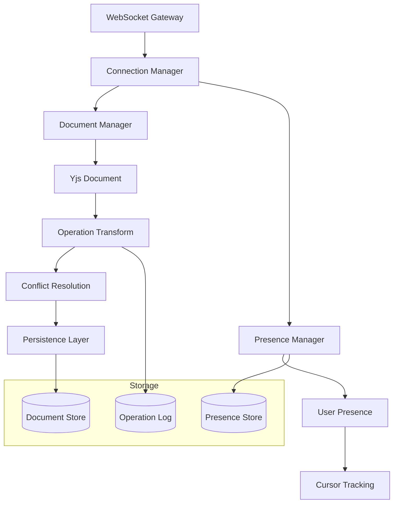
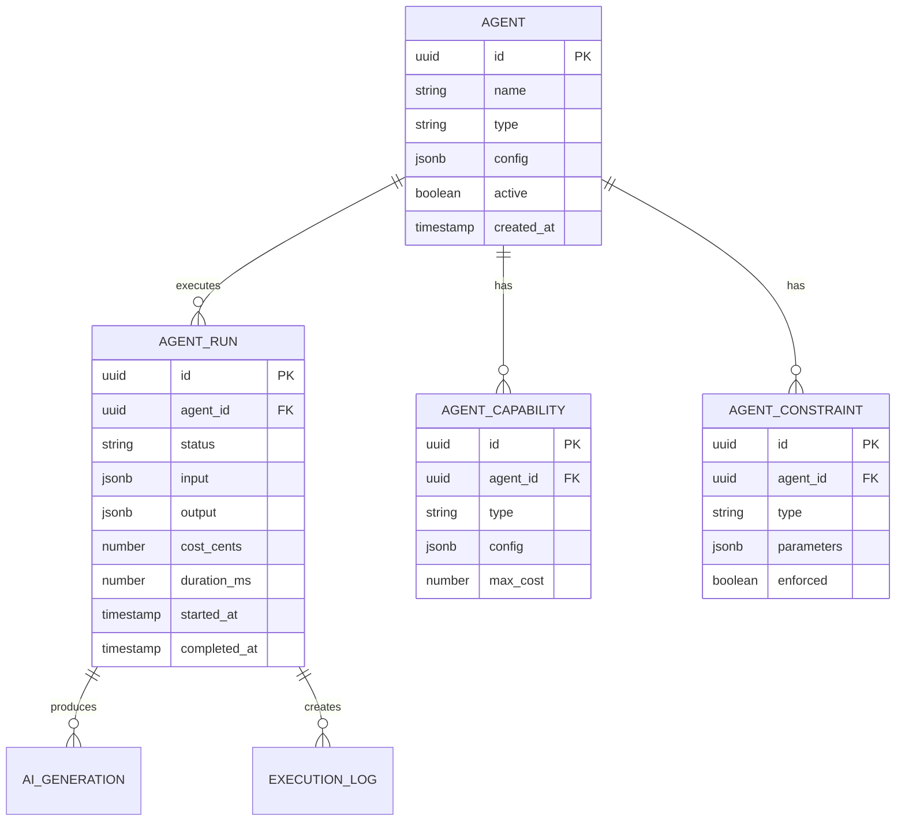
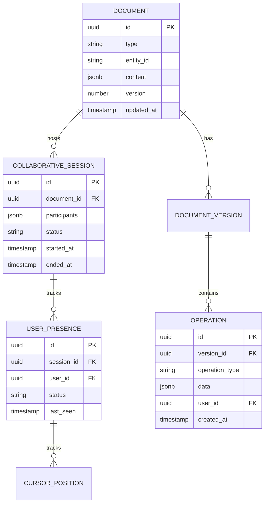
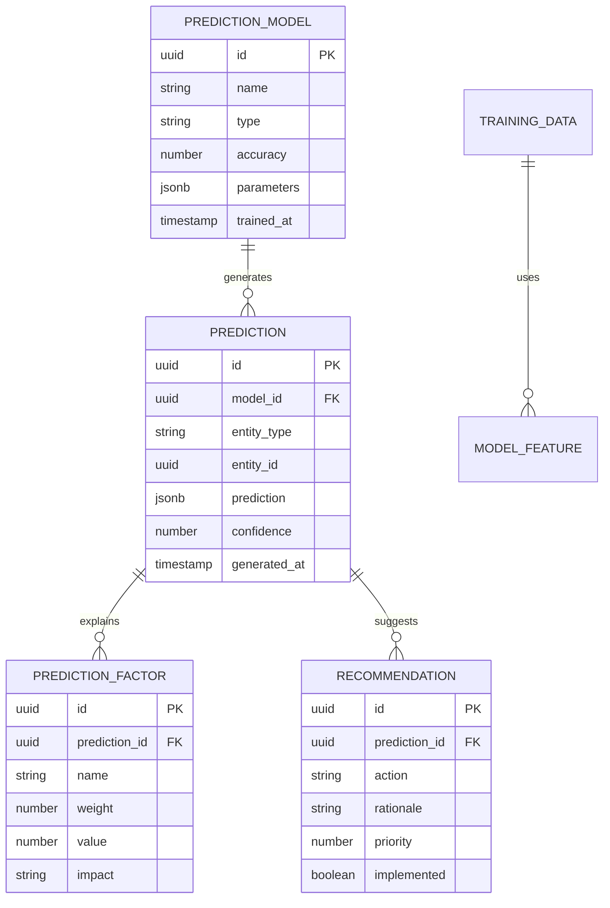
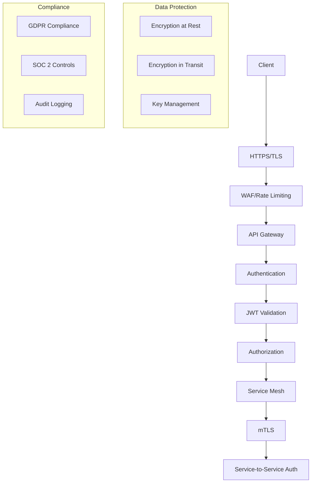

# Technical Architecture: Cutting-Edge Features Implementation

## 1. Architecture Design

### Overall System Architecture


### Microservices Architecture


## 2. Technology Description

### Core Technology Stack
- **Frontend**: React 18.2.0 + TypeScript 5.2.2 + Vite 5.0.11
- **Styling**: Tailwind CSS 3.4.1 + Framer Motion 11.0.0
- **State Management**: TanStack Query 5.17.0 + Zustand (for complex state)
- **Real-time**: Yjs 13.6.27 + Supabase Realtime + WebSockets
- **Backend**: Node.js 20.11+ + Express.js + Supabase
- **Database**: PostgreSQL 15+ + pgvector for embeddings
- **Cache**: Redis 7+ for session and data caching
- **Message Queue**: Redis Streams / RabbitMQ
- **AI/ML**: Model Router + TensorFlow.js for client-side ML
- **Blockchain**: Polygon network for audit trail
- **Container**: Docker + Docker Compose
- **Orchestration**: Kubernetes (optional for enterprise)

### New Dependencies for Cutting-Edge Features
```json
{
  "ai-agent-framework": "^1.0.0",
  "yjs": "^13.6.27",
  "y-websocket": "^3.0.0",
  "@tensorflow/tfjs": "^4.15.0",
  "pgvector": "^0.1.8",
  "ioredis": "^5.3.2",
  "ethers": "^6.9.0",
  "@polygon-io/client-js": "^2.1.0",
  "bullmq": "^5.0.0",
  "langchain": "^0.1.0",
  "@langchain/community": "^0.0.1",
  "chromadb": "^1.7.0",
  "sentence-transformers": "^1.0.0"
}
```

## 3. Route Definitions

### Frontend Routes
| Route | Purpose | New Features |
|-------|---------|--------------|
| `/crm/agents` | AI Agent Management | Create, configure, and monitor AI agents |
| `/crm/collaborate/:id` | Real-time Collaboration | Multi-user editing with presence |
| `/crm/intelligence` | Relationship Intelligence | Knowledge graph and insights |
| `/crm/analytics/predictions` | Predictive Analytics | ML-powered predictions and insights |
| `/crm/audit/blockchain` | Blockchain Audit Trail | Immutable audit logs |
| `/crm/integrations` | Integration Hub | Connect external services |
| `/crm/settings/ai-governance` | AI Governance | Cost controls and compliance |

### API Routes
| Route | Method | Purpose |
|-------|--------|---------|
| `/api/agents` | GET, POST | Agent management |
| `/api/agents/:id/run` | POST | Execute agent workflow |
| `/api/collaboration/:id` | WebSocket | Real-time collaboration |
| `/api/intelligence/graph` | GET | Relationship graph data |
| `/api/analytics/predictions` | GET, POST | ML predictions |
| `/api/audit/blockchain/:tx` | GET | Blockchain verification |
| `/api/integrations/:provider` | POST | Integration webhooks |

## 4. API Definitions

### AI Agent API
```typescript
// Request: Create AI Agent
POST /api/agents
{
  "name": "Prospecting Agent",
  "type": "research",
  "capabilities": ["web_research", "lead_enrichment", "classification"],
  "constraints": {
    "maxCostPerRun": 5.00,
    "maxExecutionTime": 300,
    "approvalRequired": true
  },
  "providers": ["perplexity", "anthropic"],
  "prompts": {
    "research": "research_lead_v2",
    "classification": "classify_lead_v1"
  }
}

// Response: Agent Created
{
  "id": "agent_123",
  "status": "active",
  "createdAt": "2026-04-22T10:00:00Z",
  "lastRun": null,
  "totalRuns": 0,
  "totalCost": 0
}
```

### Real-time Collaboration API
```typescript
// WebSocket Message Types
interface CollaborationMessage {
  type: 'presence' | 'update' | 'cursor' | 'selection';
  userId: string;
  documentId: string;
  data: any;
  timestamp: number;
}

// Presence Update
{
  "type": "presence",
  "userId": "user_123",
  "documentId": "lead_456",
  "data": {
    "status": "editing",
    "cursor": { "x": 100, "y": 200 },
    "selection": { "start": 10, "end": 20 }
  },
  "timestamp": 1713777600000
}
```

### Predictive Analytics API
```typescript
// Request: Get Prediction
GET /api/analytics/predictions?type=deal_closure&entityId=deal_123

// Response: Prediction Result
{
  "predictionId": "pred_789",
  "type": "deal_closure",
  "entityId": "deal_123",
  "prediction": {
    "probability": 0.75,
    "expectedCloseDate": "2026-05-15",
    "expectedValue": 15000
  },
  "confidence": 0.85,
  "factors": [
    {
      "name": "engagement_score",
      "weight": 0.4,
      "value": 0.8,
      "impact": "positive"
    },
    {
      "name": "deal_size",
      "weight": 0.3,
      "value": 0.6,
      "impact": "neutral"
    }
  ],
  "recommendations": [
    "Schedule follow-up call within 3 days",
    "Send case study relevant to industry"
  ],
  "generatedAt": "2026-04-22T10:00:00Z"
}
```

### Blockchain Audit API
```typescript
// Request: Store Audit Entry
POST /api/audit/blockchain
{
  "action": "ai_generation_approved",
  "userId": "user_123",
  "entityId": "ai_gen_456",
  "metadata": {
    "generationId": "gen_789",
    "approvalReason": "Accurate and relevant"
  }
}

// Response: Blockchain Transaction
{
  "transactionHash": "0x1234567890abcdef",
  "blockNumber": 12345678,
  "blockHash": "0xabcdef1234567890",
  "timestamp": "2026-04-22T10:00:00Z",
  "confirmations": 1,
  "auditEntry": {
    "id": "audit_123",
    "hash": "sha256:abcdef1234567890",
    "previousHash": "sha256:0987654321fedcba",
    "action": "ai_generation_approved",
    "userId": "user_123",
    "entityId": "ai_gen_456",
    "timestamp": "2026-04-22T10:00:00Z"
  }
}
```

## 5. Server Architecture Diagram

### AI Agent Service Architecture


### Real-time Collaboration Service


## 6. Data Model

### AI Agent Data Model


### Collaboration Data Model


### Predictive Analytics Data Model


## 7. Data Definition Language

### AI Agent Tables
```sql
-- AI Agents table
CREATE TABLE ai_agents (
    id UUID PRIMARY KEY DEFAULT gen_random_uuid(),
    name VARCHAR(255) NOT NULL,
    type VARCHAR(50) NOT NULL CHECK (type IN ('research', 'draft', 'classify', 'extract', 'reason')),
    config JSONB NOT NULL DEFAULT '{}',
    active BOOLEAN DEFAULT true,
    org_id UUID REFERENCES orgs(id) ON DELETE CASCADE,
    created_by UUID REFERENCES auth.users(id),
    created_at TIMESTAMPTZ DEFAULT NOW(),
    updated_at TIMESTAMPTZ DEFAULT NOW()
);

CREATE INDEX idx_ai_agents_org_type ON ai_agents(org_id, type);
CREATE INDEX idx_ai_agents_active ON ai_agents(active) WHERE active = true;

-- Agent capabilities
CREATE TABLE ai_agent_capabilities (
    id UUID PRIMARY KEY DEFAULT gen_random_uuid(),
    agent_id UUID REFERENCES ai_agents(id) ON DELETE CASCADE,
    capability_type VARCHAR(50) NOT NULL,
    config JSONB NOT NULL DEFAULT '{}',
    max_cost_cents INTEGER DEFAULT 100,
    timeout_seconds INTEGER DEFAULT 300,
    created_at TIMESTAMPTZ DEFAULT NOW()
);

CREATE INDEX idx_agent_capabilities_agent ON ai_agent_capabilities(agent_id);

-- Agent execution logs
CREATE TABLE ai_agent_runs (
    id UUID PRIMARY KEY DEFAULT gen_random_uuid(),
    agent_id UUID REFERENCES ai_agents(id) ON DELETE CASCADE,
    status VARCHAR(20) NOT NULL CHECK (status IN ('running', 'completed', 'failed', 'cancelled')),
    input JSONB NOT NULL,
    output JSONB,
    error_message TEXT,
    cost_cents NUMERIC(10, 2) DEFAULT 0,
    duration_ms INTEGER,
    started_at TIMESTAMPTZ DEFAULT NOW(),
    completed_at TIMESTAMPTZ,
    created_by UUID REFERENCES auth.users(id)
);

CREATE INDEX idx_agent_runs_agent ON ai_agent_runs(agent_id);
CREATE INDEX idx_agent_runs_status ON ai_agent_runs(status);
CREATE INDEX idx_agent_runs_created ON ai_agent_runs(created_by, created_at DESC);
```

### Collaboration Tables
```sql
-- Collaborative documents
CREATE TABLE collaborative_documents (
    id UUID PRIMARY KEY DEFAULT gen_random_uuid(),
    entity_type VARCHAR(50) NOT NULL,
    entity_id UUID NOT NULL,
    document_type VARCHAR(50) NOT NULL,
    content JSONB NOT NULL DEFAULT '{}',
    version INTEGER DEFAULT 1,
    is_locked BOOLEAN DEFAULT false,
    locked_by UUID REFERENCES auth.users(id),
    locked_at TIMESTAMPTZ,
    org_id UUID REFERENCES orgs(id) ON DELETE CASCADE,
    created_at TIMESTAMPTZ DEFAULT NOW(),
    updated_at TIMESTAMPTZ DEFAULT NOW(),
    UNIQUE(entity_type, entity_id, document_type)
);

CREATE INDEX idx_collab_docs_entity ON collaborative_documents(entity_type, entity_id);
CREATE INDEX idx_collab_docs_org ON collaborative_documents(org_id);

-- Document versions for history
CREATE TABLE collaborative_document_versions (
    id UUID PRIMARY KEY DEFAULT gen_random_uuid(),
    document_id UUID REFERENCES collaborative_documents(id) ON DELETE CASCADE,
    version INTEGER NOT NULL,
    content JSONB NOT NULL,
    changes JSONB NOT NULL,
    created_by UUID REFERENCES auth.users(id),
    created_at TIMESTAMPTZ DEFAULT NOW()
);

CREATE INDEX idx_doc_versions_document ON collaborative_document_versions(document_id, version);

-- User presence in documents
CREATE TABLE document_user_presence (
    id UUID PRIMARY KEY DEFAULT gen_random_uuid(),
    document_id UUID REFERENCES collaborative_documents(id) ON DELETE CASCADE,
    user_id UUID REFERENCES auth.users(id) ON DELETE CASCADE,
    status VARCHAR(20) DEFAULT 'active',
    cursor_position JSONB,
    selection_range JSONB,
    last_activity TIMESTAMPTZ DEFAULT NOW()
);

CREATE INDEX idx_presence_document ON document_user_presence(document_id);
CREATE INDEX idx_presence_user ON document_user_presence(user_id);
```

### Analytics Tables
```sql
-- Prediction models
CREATE TABLE prediction_models (
    id UUID PRIMARY KEY DEFAULT gen_random_uuid(),
    name VARCHAR(255) NOT NULL,
    type VARCHAR(50) NOT NULL CHECK (type IN ('conversion', 'churn', 'deal_size', 'timeline')),
    version INTEGER DEFAULT 1,
    accuracy_score NUMERIC(5, 4),
    feature_importance JSONB,
    model_parameters JSONB NOT NULL,
    training_data_size INTEGER,
    org_id UUID REFERENCES orgs(id) ON DELETE CASCADE,
    is_active BOOLEAN DEFAULT true,
    created_at TIMESTAMPTZ DEFAULT NOW(),
    updated_at TIMESTAMPTZ DEFAULT NOW()
);

CREATE INDEX idx_prediction_models_org ON prediction_models(org_id);
CREATE INDEX idx_prediction_models_active ON prediction_models(is_active) WHERE is_active = true;

-- Predictions
CREATE TABLE predictions (
    id UUID PRIMARY KEY DEFAULT gen_random_uuid(),
    model_id UUID REFERENCES prediction_models(id) ON DELETE CASCADE,
    entity_type VARCHAR(50) NOT NULL,
    entity_id UUID NOT NULL,
    prediction_value JSONB NOT NULL,
    confidence_score NUMERIC(5, 4),
    feature_values JSONB NOT NULL,
    explanation JSONB,
    expires_at TIMESTAMPTZ,
    created_at TIMESTAMPTZ DEFAULT NOW()
);

CREATE INDEX idx_predictions_model ON predictions(model_id);
CREATE INDEX idx_predictions_entity ON predictions(entity_type, entity_id);
CREATE INDEX idx_predictions_expires ON predictions(expires_at) WHERE expires_at IS NOT NULL;

-- Recommendation engine
CREATE TABLE recommendations (
    id UUID PRIMARY KEY DEFAULT gen_random_uuid(),
    prediction_id UUID REFERENCES predictions(id) ON DELETE CASCADE,
    action_type VARCHAR(100) NOT NULL,
    action_parameters JSONB,
    priority INTEGER DEFAULT 1,
    rationale TEXT,
    estimated_impact NUMERIC(10, 2),
    implemented BOOLEAN DEFAULT false,
    implemented_at TIMESTAMPTZ,
    created_at TIMESTAMPTZ DEFAULT NOW()
);

CREATE INDEX idx_recommendations_prediction ON recommendations(prediction_id);
CREATE INDEX idx_recommendations_priority ON recommendations(priority DESC);
```

## 8. Security & Compliance

### Security Architecture


### Data Privacy Implementation
```typescript
// Privacy-preserving data handling
interface PrivacyConfig {
  dataAnonymization: boolean;
  consentManagement: ConsentLevel;
  retentionPolicy: RetentionConfig;
  rightToErasure: boolean;
}

interface ConsentLevel {
  essential: boolean;
  analytics: boolean;
  marketing: boolean;
  aiTraining: boolean;
}

interface RetentionConfig {
  userData: '1 year' | '2 years' | 'indefinite';
  aiGenerations: '6 months' | '1 year' | '2 years';
  auditLogs: '7 years' | 'indefinite';
}
```

This technical architecture provides a comprehensive foundation for implementing cutting-edge features while maintaining security, scalability, and compliance standards required for enterprise-grade CRM systems.